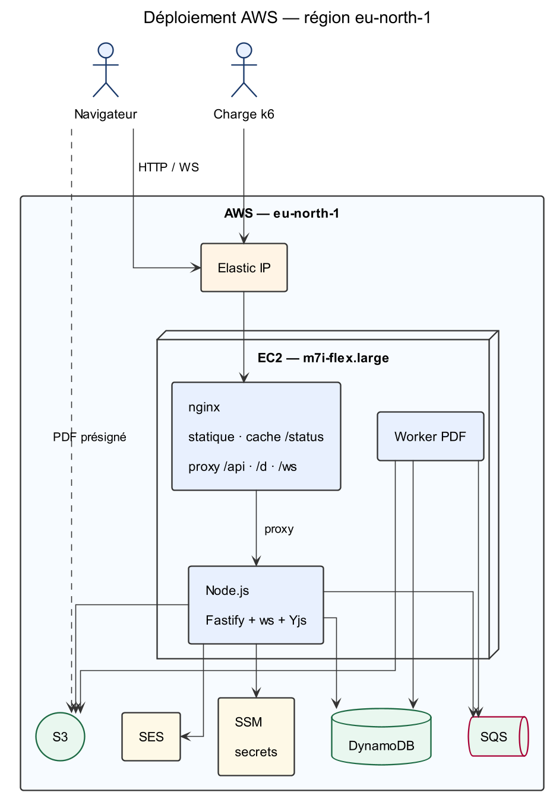

# Éditeur de documents partagé

Application web d'écriture collaborative sur AWS, doublée d'une distribution de
documents à **quota strict**.

Plusieurs centaines de rédacteurs travaillent en temps réel sur le même texte.
Le document peut ensuite être distribué par un lien public qui donne droit à
**exactement N téléchargements** en PDF, figé à l'instant où chaque visiteur
réserve son exemplaire.

**Auteur :** Djusse Tameno Christian — 5e année Génie informatique, ENSPY
**Cours :** Cloud — projet d'évaluation individuel
**Région :** `eu-north-1` (Stockholm)

## Accès

```
Application  : http://13.53.160.209
Supervision  : http://13.53.160.209/admin   (clé dans SSM, voir §8)
```

Cette adresse dépend d'une pile CloudFormation active. Si elle ne répond pas,
c'est que la pile a été supprimée pour arrêter la facturation : `./scripts/deploy.sh`
la recrée et affiche la nouvelle IP Elastic (stable d'un redéploiement à l'autre).

## Documentation

| Document | Contenu |
| - | - |
| [`docs/api.md`](docs/api.md) | Référence complète de l'API : toutes les routes, le protocole temps réel, les règles de crédit |
| [`docs/api/websocket.md`](docs/api/websocket.md) | Protocole WebSocket : messages, plafonds, cycle de connexion |
| [`docs/api/openapi.yaml`](docs/api/openapi.yaml) | Description machine de l'API REST |
| [`docs/adr/`](docs/adr/) | Sept décisions d'architecture, chacune avec ses alternatives écartées |
| [`docs/journal.md`](docs/journal.md) | Journal des défauts rencontrés et de leurs corrections |
| [`infra/README-infra.md`](infra/README-infra.md) | Free Tier, routage nginx, défauts révélés par le premier déploiement réel |
| [`tests/k6/README.md`](tests/k6/README.md) | Scénarios de charge : préparation, budget de crédit, pièges de k6 |

---

## 1. Architecture en un schéma



Tout le trafic entre par une **Elastic IP** et atteint nginx, sur la même
instance : le serveur statique, le proxy vers l'API et le WebSocket, et le
micro-cache de `/status` qui absorbe le pic de visiteurs. L'application Node
tient l'état Yjs de chaque document ouvert en mémoire et n'écrit dans DynamoDB
que par lots, une transaction par tick de 250 ms. Le PDF n'est jamais transporté
par l'instance : elle présigne une URL et laisse S3 servir le fichier.

Légende complète et versions modifiables : [`docs/diagrammes-conception/`](docs/diagrammes-conception/)
(sources PlantUML dans `puml/`, rendus dans `png/`).

Une seule pile CloudFormation ([`infra/template.yaml`](infra/template.yaml)) :
EC2 + Elastic IP + Security Group, 10 tables DynamoDB, un bucket S3 privé, une
file SQS avec file de lettres mortes, un rôle d'instance de moindre privilège et
un groupe de journaux à rétention courte.

### Les deux contraintes éliminatoires

**C1 — exactement N téléchargements.** Le décrément de `remaining` et la création
du ticket sont dans **une seule** transaction conditionnelle
(`remaining > 0 AND status = ACTIVE`, `attribute_not_exists(visitorId)`). La
transition `ACTIVE → EXHAUSTED` est une écriture séparée et idempotente
(`status = ACTIVE AND remaining = 0`). Un exemplaire est consommé **au claim**,
pas au téléchargement : réutiliser l'URL ne consomme rien de plus. Le ticket d'un
`visitorId` est cherché **avant** le court-circuit `exhausted`, sinon un visiteur
déjà servi recevrait `410` après l'épuisement.

**C2 — aucune modification perdue.** Un seul écrivain par document : un tick de
250 ms écrit **un lot** dans une transaction atomique (`seq`, journal, crédit,
marqueurs `opId`/empreinte) et diffuse **un seul** message à tous. Un `ack` ne
part qu'après le commit ; un update non acquitté est renvoyé avec le **même**
`opId`, donc dédupliqué côté serveur.

---

## 2. Prérequis

| Outil | Version | Rôle |
| - | - | - |
| Node.js | 22 | builds backend et frontend |
| AWS CLI | v2 ≥ 2.32 | `aws login`, déploiement, supervision |
| Compte AWS | — | Free Tier suffisant (voir ci-dessous) |
| OpenSSL | — | génération des secrets SSM par `deploy.sh` |
| Git + accès au dépôt | — | [`github.com/Djusse/Editeur_Partag-`](https://github.com/Djusse/Editeur_Partag-) |
| k6 | ≥ 0.41 | tests de charge (facultatif, §5.2) |

**Aucune clé d'accès AWS n'est nécessaire.** `deploy.sh` s'appuie sur
`aws login` (ou un profil SSO) ; le serveur, lui, utilise le rôle d'instance.
C'est ce qui permet d'affirmer qu'aucun secret n'est dans le dépôt (§8).

**Free Tier.** Le type d'instance par défaut est `m7i-flex.large`
(2 vCPU / 8 Gio), **éligible au Free Tier**. `t3.large` ne l'est pas et fait
échouer la création de pile avec
« The specified instance type is not eligible for Free Tier ». `deploy.sh`
interroge l'API AWS pour vérifier l'éligibilité **avant** de lancer la pile, au
lieu de tenir une liste à la main.

**Une adresse e-mail vérifiée dans SES** est requise : elle reçoit l'unique
notification envoyée quand un lien distribue son dernier exemplaire.

```bash
aws sesv2 create-email-identity --email-identity vous@gmail.com --region eu-north-1
# puis cliquer le lien reçu, et vérifier :
aws sesv2 get-email-identity --email-identity vous@gmail.com --region eu-north-1
```

SES doit être **sorti du bac à sable** pour écrire à n'importe quel destinataire.
L'usage déclaré est strictement transactionnel : un seul e-mail par lien, au
moment du dernier exemplaire, à l'adresse du créateur du lien.

---

## 3. Déploiement

### 3.1 Paramètres

Tout passe par des variables d'environnement ; les valeurs sensibles ne sont
jamais écrites dans un fichier du dépôt.

| Variable | Défaut | Rôle |
| - | - | - |
| `AWS_REGION` | `eu-north-1` | région de toutes les ressources |
| `SES_SENDER` | **requis** | adresse expéditrice vérifiée dans SES |
| `ADMIN_CIDR` | *(vide)* | plage autorisée pour SSH. **Vide ou `0.0.0.0/0` ferme le port 22** : l'accès passe alors par Session Manager |
| `KEY_NAME` | *(vide)* | paire de clés SSH. Vide = aucune clé créée, aucune clé à protéger |
| `INSTANCE_TYPE` | `m7i-flex.large` | 2 vCPU / 8 Gio, éligible Free Tier |
| `STACK_NAME` | `editeur` | nom de la pile CloudFormation |
| `PROJET` / `PROPRIETAIRE` | — | balises propagées aux ressources |

Paramètres du template, surchargeables par `--parameter-overrides` :
`CreditPerDay` (10000), `MaxUpdateBytes` (65536), `BatchMs` (300),
`TickMs` (250).

> ⚠️ Le défaut de `INSTANCE_TYPE` est défini **dans `deploy.sh` et nulle part
> ailleurs**. Il était auparavant `t3.large`, ce qui écrasait silencieusement le
> `Default` du template : le script passait toujours son propre paramètre, donc le
> template n'avait jamais voix au chapitre.

### 3.2 Commande de déploiement

```bash
git clone https://github.com/Djusse/Editeur_Partag-.git
cd Editeur_Partag-

SES_SENDER="vous@gmail.com" ./scripts/deploy.sh
```

Les six étapes, chacune échouant franchement :

| Étape | Ce qu'elle fait |
| - | - |
| 1/6 | vérifie l'identité AWS, la région et l'**éligibilité Free Tier** du type d'instance |
| 2/6 | crée la paire de clés si demandée, puis les secrets SSM `/editeur/jwt-secret` et `/editeur/admin-key` (valeurs aléatoires, une seule fois) |
| 3/6 | déploie la pile CloudFormation — en supprimant d'abord une pile en `ROLLBACK_COMPLETE`, qui ne peut plus être mise à jour |
| 4/6 | construit le backend puis le front, **libérant `node_modules` au fur et à mesure** |
| 5/6 | pousse l'archive dans S3 et demande l'installation par **SSM Run Command** |
| 6/6 | vérifie `/health`, le proxy `/d/`, le micro-cache, et affiche la clé d'administration |

Deux contraintes d'environnement expliquent la forme du script :

**CloudShell ne dispose que d'environ 1 Gio dans `$HOME`.** Le pic mesuré est de
665 Mio, les dépendances du backend puis du frontend étant libérées dès leur
build terminé. Le script refuse de démarrer en dessous de 700 Mio libres, avec
un message actionnable (vider le cache npm, supprimer les restes, ou construire
hors du home).

**Le front doit être un export statique.** Si `frontend/out` est absent, nginx
n'aurait aucun fichier à servir : le script s'arrête. Il vérifie aussi qu'aucune
URL `localhost:4000` n'a fuité dans les chunks — les variables `NEXT_PUBLIC_*`
sont inlinées à la compilation, et un `.next` résiduel d'un `next dev` fige une
mauvaise origine.

### 3.3 Vérification

```bash
# 1. le processus répond
curl -s http://<elastic-ip>/health
# → {"status":"ok","uptime":12,"mode":"production"}

# 2. le parcours visiteur est proxifié (réponse JSON de Node, pas un 404 HTML)
curl -s http://<elastic-ip>/d/inexistant/status
# → {"error":"NOT_FOUND", ...}

# 3. première connexion dans le navigateur
open http://<elastic-ip>
```

La première connexion demande un nom et un e-mail — **il n'y a pas de mot de
passe**. L'e-mail est l'identité, et le jeton de session dure 7 jours.

Parcours de validation manuel :

1. créer un document, écrire ;
2. l'ouvrir dans un second navigateur : la frappe arrive dans les deux, la
   présence et les curseurs apparaissent ;
3. créer un lien à 2 exemplaires, ouvrir `/d?token=…` en fenêtre privée :
   « Prêt à réserver » → « Patienter » → « Prêt » ; un troisième onglet affiche
   « Ce lien est épuisé. » ;
4. rafraîchir après téléchargement : le même visiteur retrouve son exemplaire
   sans en consommer un autre.

Micro-cache nginx, avec un vrai jeton (un jeton inexistant renvoie 404, que
`proxy_cache_valid 200` ne mémorise pas) :

```bash
curl -sI http://<elastic-ip>/d/<token>/status | grep X-Cache-Status   # EXPIRED
curl -sI http://<elastic-ip>/d/<token>/status | grep X-Cache-Status   # HIT
```

Journaux et diagnostic :

```bash
aws ssm start-session --target <instance-id> --region eu-north-1
sudo tail -f /var/log/editeur/app.log
```

---

## 4. Tests

### 4.1 Tests unitaires et d'intégration (en local)

Aucun cloud requis : S3, SQS, SES, DynamoDB et les secrets sont injectables ou
doublés en mémoire.

```bash
cd backend
npm install
npm test
```

**43 tests**, tous verts en 11 s :

| Fichier | Tests | Ce qui est prouvé |
| - | - | - |
| `test/claim.test.ts` | 11 | **C1** : N exact, 50 claims concurrents pour N=20, idempotence, ticket renvoyé après épuisement, T1 figée, un seul job PDF par version |
| `test/credit.test.ts` | 16 | **C4** : débit exact, plafond, multi-appareils, `opId` rejoué, contenu identique sous un autre `opId`, suppressions facturées, séquence contiguë, restauration gratuite, blocage au 4ᵉ refus, isolation d'un refus dans un lot, jour métier à minuit heure de Douala |
| `test/yjs-update.test.ts` | 7 | comptage sur de vrais updates Yjs : insertions, suppressions, update complet, unicode, update corrompu |
| `test/email.test.ts` | 9 | notification : envoi au seul dernier exemplaire, idempotence, panne SES sans impact visiteur, relâchement du verrou, échappement HTML, pluriel |

> Le double en mémoire de DynamoDB a été rendu **plus strict** que permissif
> après deux pannes de production : il refuse désormais l'arithmétique entre
> valeurs dans une `ConditionExpression` et les mots réservés non aliasés
> (`token`, `seq`). Un faux service qui n'imite que les succès laisse passer du
> code cassé — 42 tests verts n'avaient pas vu que
> `used + :chars <= :limit` est **refusé** par DynamoDB.

**Serveur complet sans AWS**, avec WebSocket natif et PDF réel :

```bash
# Terminal 1
cd backend && npm install && npm run local

# Terminal 2
cd frontend && npm install && npm run dev:local
```

Ouvrir <http://localhost:3000> : deux onglets convergent réellement.

> **Ne lancez pas `npx next dev` directement** : ce script définit
> `NEXT_PUBLIC_API_BASE=http://localhost:4000/api` et
> `NEXT_PUBLIC_WS_BASE=ws://localhost:4000/ws`. Sans ces variables, le client
> appelle `/api` sur le port 3000 — qui ne sert pas l'API.

Scripts d'intégration, serveur local démarré (chacun affiche un bilan chiffré) :

```bash
cd backend
node e2e-local.mjs                # parcours complet, WebSocket + PDF + CORS
node test-credit-exhaustion.mjs   # C4 : épuisement, refus, blocage, readOnly
node test-link-real.mjs           # C1 côté navigateur : contrat d'URL du parcours visiteur
node test-visitor-routes.mjs      # non-régression : /d/... est à la racine, pas sous /api
node test-restore-2clients.mjs    # restauration de version avec deux clients CRDT
node test-versions.mjs            # versions et restauration
node test-persistence.mjs         # reprise après redémarrage du serveur
```

```bash
# le bundle client vise-t-il la bonne API ? (le serveur peut être sain et le
# client faux : c'est arrivé trois fois, voir le journal)
node tests/node/verify-client-bundle.mjs --dev
```

Outils de développement réservés au mode local — `src/server/main.ts` ne les
connaît pas. Le blocage dure jusqu'à la remise à zéro (minuit heure de Douala),
donc pour rejouer un scénario sans attendre :

```bash
curl -X POST http://localhost:4000/__reset-credit \
  -H 'content-type: application/json' -d '{"email":"vous@exemple.cm"}'
curl -s http://localhost:4000/__debug   # clé d'admin + lignes par table
```

### 4.2 Tests de charge

Le générateur doit tourner **dans la même région AWS que l'instance** : depuis un
poste local, on mesurerait le réseau, pas l'application.

```bash
# Sur une EC2 dédiée (t3.small suffit pour la charge elle-même)
sudo ./tests/k6/install-k6.sh
k6 version
```

Le dépôt contient [`tests/k6/run.sh`](tests/k6/run.sh:1) (crée `tests/results/`,
sans quoi k6 perd son résumé JSON) et quatre scénarios :

| Scénario | Contrainte | Ce qu'il mesure |
| - | - | - |
| [`s1-claim.js`](tests/k6/s1-claim.js:1) | **C1** | 15 000 claim sur un lien de 500 exemplaires, 80 % du pic en 60 s |
| [`s2-convergence.js`](tests/k6/s2-convergence.js:1) | **C2** | N rédacteurs, une seule connexion persistante chacun, chaque update émis doit recevoir son `ack` |
| [`s5-mixte.js`](tests/k6/s5-mixte.js:1) | **C5** | visiteurs et rédacteurs **simultanément**, plus sondes `/status` pour mesurer le micro-cache |
| [`s7-robustesse.sh`](tests/k6/s7-robustesse.sh:1) | robustesse | `kill -9` du processus en pleine écriture, redémarrage systemd, journal contigu |

**S1 — C1 : quota exact sous pic.**

```bash
API_URL=http://<elastic-ip> ./tests/k6/run.sh s1 \
  -e TOKEN=<jwt> -e MAX_DOWNLOADS=500 -e VISITORS=15000
```

Verdict attendu : `s1_reserved = 500` exactement, `remaining` final à 0, statut
`exhausted`, aucun 5xx. Essai rapide : `-e MAX_DOWNLOADS=10 -e VISITORS=200`.

**S2 — C2 : N rédacteurs dans le même document.**

```bash
# comptes de charge, tous ajoutés comme rédacteurs du document
./tests/k6/mktokens.sh 4 /tmp/tokens.txt "$DOC_ID" "$OWNER_TOKEN"

API_URL=http://<elastic-ip> ./tests/k6/run.sh s2 \
  -e TOKEN=$(cut -d: -f2 /tmp/tokens.txt | paste -sd, -) -e DOC_ID=$DOC_ID \
  -e WRITERS=50 -e DURATION=45s -e PACE_MS=1000
```

Paliers : 50, puis 100, puis 300. Le palier retenu est le plus haut où
`s2_missing_ack` reste à 0.

Trois propriétés du scénario méritent d'être connues, chacune corrigeant un
défaut qui rendait la mesure vide :

| Point | Pourquoi |
| - | - |
| connexion **persistante** par VU | ouvrir une connexion par update bouclait ~110 fois/s : 220 caractères/s, les 10 000 caractères quotidiens partaient en 45 s et le test mesurait le blocage de crédit |
| `sinceSeq` lu depuis `/state` | avec `0`, tout le journal est rejoué à chaque connexion : mesuré à 90 513 messages reçus pour 0 update acquitté |
| budget de crédit affiché au démarrage | `ceil(WRITERS/jetons) × DURATION/PACE_MS` ; S2 prévient s'il dépasse 10 000 |

Le crédit étant de 10 000 caractères par **e-mail**, à plus d'un jeton on répartit
les VUs avec `-e TOKEN=j1,j2,j3`.

**S5 — C5 : le pic complet.**

```bash
API_URL=http://<elastic-ip> ./tests/k6/run.sh s5 \
  -e TOKEN=<jwt> -e DOC_ID=$DOC_ID \
  -e VISITORS=15000 -e MAX_DOWNLOADS=500 -e WRITERS=300 -e WRITER_DURATION=120s
```

Essai à blanc (`RAMP_SCALE=0.15` ramène 115 s à ~17 s) :

```bash
API_URL=http://<elastic-ip> ./tests/k6/run.sh s5 \
  -e TOKEN=<jwt> -e DOC_ID=$DOC_ID -e VISITORS=200 -e MAX_DOWNLOADS=10 \
  -e WRITERS=4 -e WRITER_DURATION=10s -e RAMP_SCALE=0.15
```

Pendant le tir, relever le CPU de l'instance :

```bash
aws cloudwatch get-metric-statistics --namespace AWS/EC2 \
  --metric-name CPUUtilization --dimensions Name=InstanceId,Value=<id> \
  --start-time $(date -u -d '10 minutes ago' +%Y-%m-%dT%H:%M:%SZ) \
  --end-time $(date -u +%Y-%m-%dT%H:%M:%SZ) --period 60 \
  --statistics Maximum Average --region eu-north-1 --output table
```

Un `✗` en fin de scénario n'est pas un échec de test : k6 renvoie le **code 99**
quand un seuil casse, et c'est ce code qui fait foi. Les scripts énumèrent
eux-mêmes les seuils en échec (`SEUIL EN ÉCHEC : …`).

### 4.3 Scripts de vérification de C1 et de C2

k6 mesure le **débit** (un update émis a-t-il reçu un `ack`). Il ne fait pas
tourner de client Yjs et ne peut donc pas prouver la **convergence du contenu**.
Deux scripts complètent cette preuve.

**C1 — quota exact**, après S1 :

```bash
TOKEN=<jwt> DOC_ID=<doc> API_URL=http://<elastic-ip> ./tests/k6/run.sh s1 …
# puis vérification du compteur côté serveur :
curl -s http://<elastic-ip>/api/documents/$DOC_ID/links \
  -H "authorization: Bearer $TOKEN"
# → remaining: 0, status: "EXHAUSTED"
```

**C2 — contiguïté du journal et convergence du contenu**, après S2 :

```bash
node tests/node/verify-convergence.mjs \
  --api=http://<elastic-ip>/api --token=<jwt> --doc=<docId>
```

Le script lit `/state` (état Yjs compacté), puis **boucle** sur
`/updates?since=` jusqu'à épuisement du journal, et vérifie trois choses :

| Contrôle | Signification |
| - | - |
| `trous: 0` | les `seq` sont contigus : aucune écriture acceptée n'est absente du journal |
| `seqCoherent: true` | le dernier `seq` du journal est celui qu'annonce `/state` |
| `reconstructionStable: true` | deux reconstructions indépendantes donnent la même empreinte SHA-256 |

Verdict attendu : `"verdict": "CONVERGENCE OK"`, code de sortie 0.

> ⚠️ La boucle de pagination est **indispensable** : `/updates` s'arrête à
> 2000 entrées sans signaler la troncature. Un appel unique sur un document ancien
> donnerait un journal partiel et conclurait à tort à la convergence.
>
> Ce vérificateur a été validé dans les deux sens : `CONVERGENCE OK` sur un
> journal sain, et `ÉCHEC` dès qu'un `seq` manque. Un test qui ne sait pas
> détecter la panne qu'il prétend chercher ne prouve rien.

---

## 5. Suppression complète

```bash
./scripts/destroy.sh          # demande confirmation (« supprimer »)
./scripts/destroy.sh --yes    # sans confirmation
```

Un simple `aws cloudformation delete-stack` **ne suffit pas** :

- le bucket S3 est **versionné** : `delete-stack` échoue tant qu'il contient des
  objets, et supprimer les objets courants laisse les versions et les marqueurs
  de suppression ;
- les paramètres SSM `/editeur/*` et la paire de clés vivent **hors de la pile**
  et subsistent après sa suppression ;
- une file SQS résiduelle d'un déploiement interrompu n'est rattachée à aucune
  pile.

Le script enchaîne :

| Étape | Action |
| - | - |
| 1/5 | inventaire de ce qui existe réellement |
| 2/5 | purge du bucket : objets **et** versions, marqueurs compris |
| 3/5 | suppression de la pile et attente de fin (seconde purge si besoin) |
| 4/5 | paramètres SSM, paire de clés, files SQS résiduelles |
| 5/5 | **vérification finale** sur 8 familles de ressources |

La vérification finale distingue trois états par ressource : `OK` (absente),
`RESTE` (présente et facturable), `ERREUR` (contrôle impossible, état **inconnu**).
Le script se termine en **erreur** s'il reste une ressource facturable *ou* si un
contrôle n'a pas pu s'exécuter.

> **Avant toute suppression** : exporter `tests/results/` et les extraits
> CloudWatch. Les groupes de logs disparaissent avec la pile.

Après suppression, seuls restent des objets hors périmètre : le fichier
`<KEY_NAME>.pem` éventuellement téléchargé, et l'identité SES vérifiée.

---

## 6. Structure du dépôt

```
backend/                  Node.js 22 / TypeScript
  src/lib/                claim, crédit, comptage Yjs, PDF, versions, email,
                          DynamoDB, S3, SQS, secrets, identifiants
  src/realtime/           hub (écrivain unique), gestionnaire de documents,
                          protocole ws, tickets à usage unique
  src/routes/             routes Fastify : /api/* et parcours visiteur /d/*
  src/server/             main.ts (Fastify + ws), worker.ts (SQS), app.ts
  src/local/              mode local complet, sans AWS
  test/                   43 tests (Vitest) + helpers (memory-db, setup)
  *.mjs                   scripts d'intégration de bout en bout
frontend/                 Next.js 14, export statique, thème clair
  src/app/                /, /documents, /doc, /d, /bloque, /admin
  src/lib/                client API, provider Yjs, éditeur CodeMirror
  src/components/         TopBar, Modale, Toasts
infra/                    template.yaml (CloudFormation), samconfig, README-infra
scripts/                  deploy.sh, destroy.sh
docs/                     api.md, api/, adr/, journal.md
tests/k6/                 S1, S2, S5, S7 + lib/ + outils (mktokens, run, install)
tests/node/               verify-convergence.mjs, verify-client-bundle.mjs
```

Les décisions sont justifiées une à une dans [`docs/adr/`](docs/adr/) :

| ADR | Sujet |
| - | - |
| [001](docs/adr/001-calcul-ec2.md) | Une instance EC2 plutôt que Lambda + API Gateway |
| [002](docs/adr/002-hub-ecrivain-unique.md) | Hub : écrivain unique, tick 250 ms, transaction atomique |
| [003](docs/adr/003-claim-gardememoire.md) | Claim : garde en mémoire + transaction conditionnelle |
| [004](docs/adr/004-crdt-yjs.md) | Fusion CRDT avec Yjs |
| [005](docs/adr/005-pdf-sqs.md) | PDF asynchrone (SQS), construit à la version figée |
| [006](docs/adr/006-credit-serveur.md) | Crédit : comptage serveur depuis le binaire Yjs |
| [007](docs/adr/007-front-http-sans-https.md) | Front statique servi par nginx, en HTTP sans domaine |

---

## 7. Sécurité : où sont les secrets

**Aucune clé d'accès AWS n'est dans le code, ni dans l'historique Git, ni dans le
template.** C'est vérifiable :

```bash
git log --all -p | grep -Ei 'AKIA|aws_secret_access_key|BEGIN .*PRIVATE KEY' || echo "aucune clé"
grep -rEi 'AKIA[0-9A-Z]{16}' --exclude-dir=node_modules . || echo "aucune clé"
```

| Secret | Où il vit | Comment il est créé |
| - | - | - |
| Identifiants AWS (poste) | `aws login` / profil SSO, hors dépôt | par l'utilisateur |
| Identifiants AWS (serveur) | **rôle d'instance**, identifiants temporaires | par CloudFormation |
| Secret de signature JWT | SSM `SecureString` `/editeur/jwt-secret` | `openssl rand -base64 48`, par `deploy.sh` |
| Clé d'administration | SSM `SecureString` `/editeur/admin-key` | `openssl rand -hex 16`, par `deploy.sh` |

Les deux paramètres SSM sont créés **une seule fois** et conservés lors des
redéploiements : changer le secret JWT invaliderait toutes les sessions en cours.
Ils ne figurent ni dans le template, ni dans le *user data* — ce dernier est
lisible via les métadonnées de l'instance.

Autres mesures :

| Mesure | Détail |
| - | - |
| Moindre privilège | rôle d'instance limité aux tables nommées, au préfixe S3, à la file SQS, et `ses:SendEmail` filtré sur l'expéditeur vérifié |
| S3 | accès public bloqué, chiffrement AES256, versionnage, stratégie refusant le trafic non HTTPS, URL présignées de 60 s |
| Security Group | 80 ouvert ; 22 **fermé** par défaut (`ADMIN_CIDR` vide), accès par Session Manager |
| IMDSv2 | `HttpTokens: required` — le *user data* ne peut pas être lu sans jeton de session |
| Jeton WebSocket | ticket à usage unique de 60 s, pour ne pas exposer le JWT dans l'URL (donc dans les journaux nginx) |
| Mots de passe | aucun : l'identité est un e-mail, la signature du JWT fait foi |
| Validation | e-mail, titre (120), `opId` (100), update (64 Kio), corps JSON (1 Mio) |
| Journaux | rétention 7 jours |

---

## 8. Limites connues

Ces limites sont **assumées et argumentées** dans les ADR et le dossier de
conception ; elles sont reprises ici pour qu'aucune ne soit une surprise.

### Sécurité et protocole

| Limite | Conséquence | Pourquoi |
| - | - | - |
| **HTTP sans TLS** | jetons et e-mails circulent en clair sur le réseau | pas de nom de domaine dans le sujet ; un certificat exige un domaine. Argumenté dans l'[ADR 007](docs/adr/007-front-http-sans-https.md) |
| **Identité sans mot de passe** | quiconque connaît une adresse peut écrire en son nom | autorisé par le sujet ; l'e-mail est la clé de crédit et de partage |
| **Jeton non révocable** | un JWT volé reste valable jusqu'à `exp` (7 jours) | pas de liste de révocation ; refaire `POST /api/session` en cas de besoin |
| **Pas de révocation de lien** | un lien distribué ne peut pas être coupé, seulement épuisé | la table ne porte pas de champ `revokedAt` |
| **Partage additif** | on ajoute un membre, on n'en retire pas | aucune route de retrait |

### Capacité et disponibilité

| Limite | Conséquence | Pourquoi |
| - | - | - |
| **Instance unique** | pas de haute disponibilité : un arrêt d'EC2 interrompt le service ; le redémarrage systemd ramène le processus, pas la machine | un seul écrivain par document est ce qui rend C2 simple à tenir ([ADR 002](docs/adr/002-hub-ecrivain-unique.md)) |
| **État du hub en mémoire** | un redémarrage force le rechargement depuis DynamoDB et invalide les tickets WebSocket en vol | les clients se reconnectent et rejouent leurs `pendingOps` |
| **Rattrapage plafonné à 2000 entrées** | `/updates` ne signale pas la troncature ; un client doit boucler | borne la mémoire d'une réponse HTTP |
| **`/status` en micro-cache 1 s** | l'épuisement d'un lien peut être visible avec 1 s de retard | c'est ce qui absorbe le pic de 15 000 visiteurs sans toucher DynamoDB |
| **Garde de claim : 50 simultanés par lien** | au-delà, `202 waiting` | protège DynamoDB du *throttling* ; la garde ne décide **jamais** du quota |

### Fonctionnel

| Limite | Conséquence |
| - | - |
| **Un seul type de contenu** | un document est un texte brut formaté ; pas d'images ni de tableaux |
| **Crédit par e-mail, pas par appareil** | 5 onglets consomment le même quota de 10 000 caractères/jour |
| **Restaurations non facturées** | une restauration de version est gratuite et franchit un blocage : c'est un recours voulu, mais le quota ne reflète donc pas tout le travail effectué |
| **SES hors bac à sable requis** | en bac à sable, seule l'adresse vérifiée reçoit la notification de fin de quota |

### Ce qui n'est pas mesurable en local

Le pic de charge (C5) et le comportement de nginx ne se testent que sur le
déploiement réel : la machine de charge doit être dans la même région. Les tests
unitaires et les scripts `.mjs` couvrent le fonctionnel, pas la tenue en charge.

---

## 9. Transparence

- Toutes les bibliothèques utilisées sont **open source** : Yjs, CodeMirror 6,
  pdfkit, Fastify, `ws`, AWS SDK, Next.js.
- Un **assistant IA** a été utilisé pour la rédaction du code, des tests et de la
  documentation. Chaque affirmation sur les contraintes est adossée à un test
  exécutable (`backend/test/`), à un script d'intégration ou à un scénario de
  charge — de sorte que le comportement est vérifiable indépendamment de la façon
  dont le code a été produit.
- Les défauts trouvés en cours de route et leurs corrections sont consignés dans
  [`docs/journal.md`](docs/journal.md). Les plus coûteux n'étaient pas des erreurs
  de logique mais des **écarts entre l'environnement réel et son imitation** :
  `nginx` sans `/var/cache`, `cfn-signal` absent d'AL2023, DynamoDB refusant
  l'arithmétique et les mots réservés, `k6` sans `WebSocket` global.
